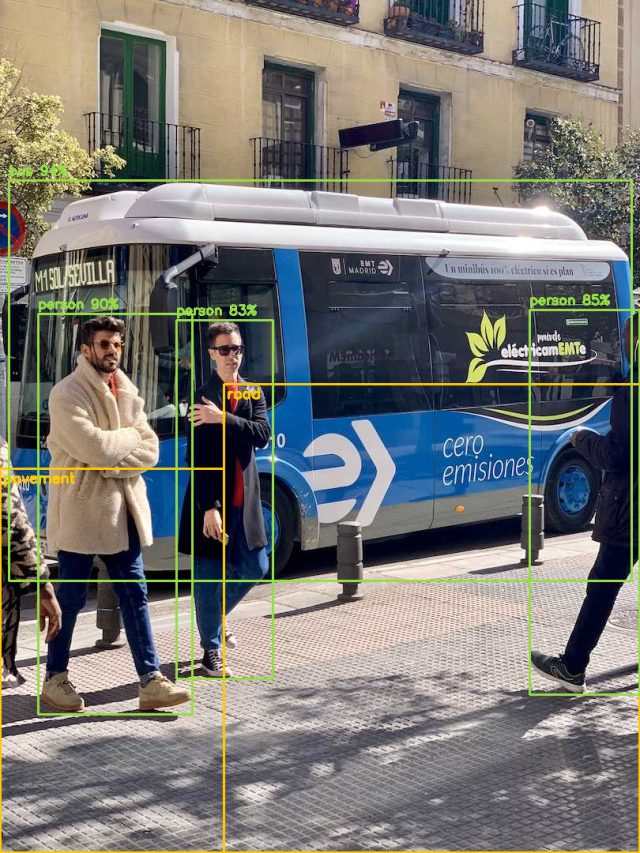
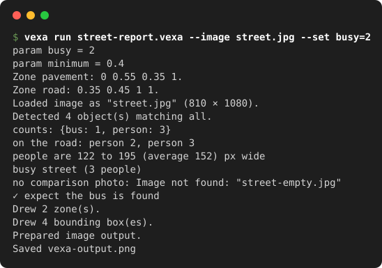
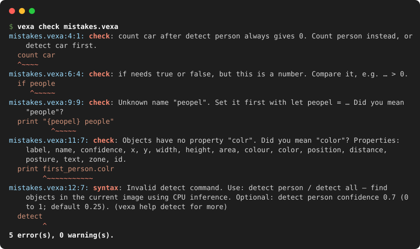

# Vexa

A small language for computer vision. Programs read like the question you are asking, are checked before they run, and run offline on a laptop CPU.

```vexa
load "street.jpg"
detect person
count person
draw boxes
show image
```

<p align="center">
  
  
</p>

## Try it

Install [uv](https://docs.astral.sh/uv/getting-started/installation/), then:

```sh
uv tool install --python 3.12 https://github.com/Dharun235/Vexa/releases/download/v0.7.0a1/vexa-0.7.0a1-py3-none-any.whl
git clone --depth 1 https://github.com/Dharun235/Vexa && cd Vexa/examples
vexa run street-report.vexa --image street.jpg
```

The object detector, segmenter and OCR models are included. Other models download once with `vexa model download NAME`; a program that needs one tells you which.

## Why a language?

- **Readable.** `count colour red car`, `blur face`, `count person in zone door`, `rank all by distance`.
- **Checked before it runs.** Mistakes are found without an image or a model, all at once, with the fix:

  

- **A real language.** Variables, lists and maps, objects with properties (`car.colour`, `car.distance`), loops, functions, `try`, settings with `param`, libraries.
- **Interpreted or compiled.** `vexa run` interprets; `vexa compile` writes an optimised Python script with identical results.
- **Offline and private.** Every model is a local ONNX file on CPU. A program can only read images and write the files it names.

## What it can do

| Task | Commands |
| --- | --- |
| Find | `detect person`, `detect "sunglasses"`, `locate "red tie"`, `segment detections`, `ocr`, `scan codes`, `caption` |
| Measure | `count`, `measure`, `where`, `colour`, `estimate depth`, `estimate poses`, `check exposure` |
| Change | `blur face`, `remove background`, `style cartoon`, `translate horse to zebra`, `rotate`, `crop` |
| Batch and video | `for each image in "photos/"`, `for each frame in "clip.mp4"`, `zone`, `track`, `record`, `save csv` |
| Tools | `vexa check`, `run`, `test`, `compile`, `fmt`, `repl`, and an editor server with a [VS Code extension](editors/vscode/README.md) |

## Learn more

- [Tutorial](docs/tutorial.md): install and learn the language in ten short lessons.
- [Reference](docs/language-reference.md): every command and language feature, by task.
- [Specification](docs/specification.md): grammar, types and rules, precisely.
- [Editors](docs/editors.md), [How Vexa works](docs/architecture.md), [Examples](examples/), [Changelog](CHANGELOG.md), [Contributing](CONTRIBUTING.md).

Built by Dharunkumar Senthilkumar, with [Claude Code](https://claude.com/claude-code) as a co-author on the commits.

Vexa's code is [MIT licensed](LICENSE). The bundled models keep their own licences (YOLO11n is AGPL-3.0, EfficientSAM is Apache-2.0); see [LICENSES](LICENSES/README.md).
